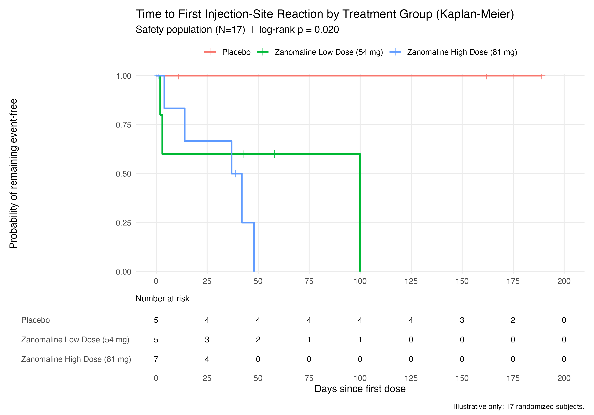

# F-14-1  Time to First Injection-Site Reaction by Treatment Group (Kaplan-Meier)

**Protocol:** CDISCPILOT01  |  **Population:** Safety Population  |  **Reason:** SPECIFIED IN SAP

**Analysis set:** `SAFFL = 'Y'`  —  Placebo N=5, Zanomaline Low N=5, Zanomaline High N=7, Total N=17

#### Summary statistics

| Treatment group | N | Events | Censored | Median (days) | 95% CI |
|---|---|---|---|---|---|
| Placebo | 5 | 0 (0.0%) | 5 (100.0%) | NE | (NE, NE) |
| Zanomaline Low Dose (54 mg) | 5 | 3 (60.0%) | 2 (40.0%) | 100.0 | (3.0, NE) |
| Zanomaline High Dose (81 mg) | 7 | 5 (71.4%) | 2 (28.6%) | 39.5 | (14.0, NE) |

Log-rank p-value across treatment groups: **0.020**

---

### Notes

- ADTTE PARAMCD 'TTISR' derived from SDTM FA (FACAT = 'INJECTION SITE REACTION', 78 records) joined to the AE/EX timeline: AVAL = first FADTC with FAORRES indicating occurrence, minus TRTSDT, +1. Censor at last on-study day (CNSR=1) for subjects with no reaction.
- The USDM endpoint END3 describes a transdermal APPLICATION-site signal; the delivered study is a SUBCUTANEOUS INJECTION. Title and derivation follow the delivered route. Record as a reporting deviation (critic finding R-7).
- Figure must include a number-at-risk table. At 17 subjects the log-rank p-value is uninterpretable.
- N-GATE CAVEAT: this study has 17 randomized subjects (Placebo 5 / Low 5 / High 7). All inferential statistics are illustrative and must not be interpreted.
- NE = not estimable (median not reached).
- The figure carries a number-at-risk panel beneath the curves, built manually: `ggsurvfit::add_risktable()` errors under the installed ggsurvfit 1.1.0 / ggplot2 4.0.2.9000 combination. At-risk counts are in the ARD (`stat_name = n_at_risk`).
- All values computed from ADaM via the persisted ARD (`ard.csv`); no value is hand-entered.
- Rounding: SAS convention (half away from zero), applied at display time only.

> **N-GATE WARNING.** This study randomized 17 subjects (Placebo 5 / Zanomaline Low 5 / Zanomaline High 7). Every inferential statistic in this display is **illustrative only** and must not be interpreted as evidence of effect or of absence of effect.
